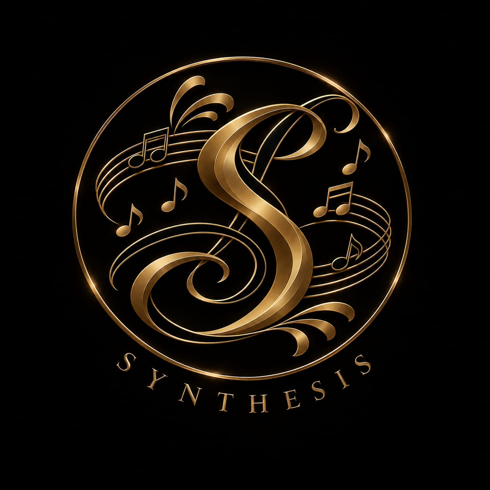
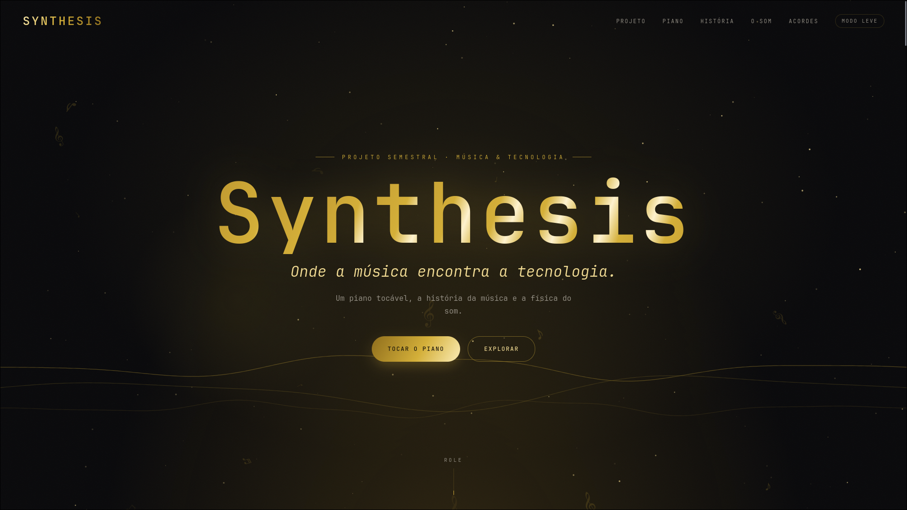

<div align="center">



# 🎹 Synthesis

**Onde a música encontra a tecnologia.**

Um piano tocável no navegador, a história da música e a física do som.
Tudo feito com código, sem nenhum arquivo de áudio.


</div>

---

<div align="center">



</div>

---

## 📖 Sobre

O **Synthesis** é um site estático feito para acompanhar o case mod de mesmo nome, em que um
piano digital vira a carcaça de um computador. É o nosso projeto semestral para a
**ExpoTech do 2º semestre de 2026**.

O site é **servido de dentro do próprio piano**: o PC instalado nele roda um **Windows Server**
com uma **VM Ubuntu**, e é essa VM que hospeda o site na rede local durante o evento. Quem
estiver visitando abre o site e toca o piano no navegador enquanto o piano de verdade é o
servidor.

O site junta música e tecnologia em cinco seções:

1. **O Projeto:** o que é o Synthesis e o computador que vive dentro do piano
2. **O Piano:** um piano tocável
3. **Uma História da Música:** quatro séculos de música em oito momentos
4. **A Física do Som:** um laboratório de ondas
5. **A Arte dos Acordes:** acordes e harmonia no teclado

---

## ✨ Funcionalidades

### 🎹 Piano tocável

- **2 oitavas (C4–C6):** teclado montado por código em `js/keyboard.js`.
- **Mouse, toque e teclado:** dá para clicar, tocar com o dedo (e deslizar entre as teclas) ou
  usar o teclado do computador. O mapeamento usa a posição física das teclas, então funciona
  em ABNT2 e no padrão americano.
- **Músicas de demonstração:** *Für Elise*, *Ode à Alegria* e *Brilha, Brilha Estrelinha*,
  tocadas pelo próprio site com as teclas acendendo.
- **Gravação e reprodução:** grave o que tocou e ouça de volta.
- **Volume** e opção de **mostrar ou esconder** o nome das teclas.
- **Visualizador de onda em tempo real:** mostra o som enquanto você toca.

| Teclas do computador | Notas |
| --- | --- |
| `Z X C V B N M` | teclas brancas da 1ª oitava (C4–B4) |
| `S D` · `G H J` | teclas pretas da 1ª oitava |
| `Q W E R T Y U I` | teclas brancas da 2ª oitava (C5–C6) |
| `2 3` · `5 6 7` | teclas pretas da 2ª oitava |

### 🔊 Som 100% sintetizado

O site **não tem nenhum arquivo de áudio**. Todo o som é gerado na hora com a
**Web Audio API** (`js/audio.js`):

- **Timbre de piano** montado com vários osciladores, um para cada harmônico.
- **Envelope** de ataque e decaimento, para a nota soar e sumir como num piano.
- **Filtro** que deixa o som mais suave.
- **Reverb** feito por código: um eco de sala artificial gerado a partir de ruído.

### 📜 Uma história da música

Linha do tempo com **8 períodos**, cada um com uma descrição curta e nomes importantes:

**Barroco** (1600) · **Clássico** (1750) · **Romântico** (1820) · **Jazz** (1910) ·
**Rock** (1950) · **Bossa Nova** (1958) · **Eletrônica** (1970) · **Era Digital** (2000)

### 🌊 A física do som

Laboratório de ondas (`js/sound-wave.js`): a onda é desenhada num canvas e dá para **ouvir**
o resultado.

- **Frequência:** do grave ao agudo, mostrando a nota mais próxima (ex.: `440.0 Hz ≈ Lá (A4)`).
- **Amplitude:** o volume da onda.
- **Timbre:** senoidal, triangular, quadrada ou dente de serra.
- **Oitavas do Lá:** atalhos para 220, 440 e 880 Hz.
- **Cartões explicativos** sobre frequência, amplitude, timbre e oitava.

### 🎼 A arte dos acordes

Cada botão toca um acorde e **acende as teclas** que o formam, com a fórmula explicada
(`js/chords.js`):

- **8 acordes:** C, Dm, Em, F, G, Am, G7 e C7M (maiores, menores, com sétima e com sétima maior).
- **Progressão I – V – vi – IV:** toca C – G – Am – F, a progressão mais famosa da música pop.

### 🖥️ A Máquina

A seção *O Projeto* mostra as peças do computador que fica dentro do piano.

<details>
<summary>Ver as especificações</summary>

| Peça | Modelo | Detalhes |
| --- | --- | --- |
| **Processador** | Intel Core i5-3470 | 4 núcleos / 4 threads · 3,20 GHz (3,60 GHz Turbo) · 6 MB de cache · LGA 1155 |
| **Placa-mãe** | GBT H61MHVD3 | Chipset Intel H61 · LGA 1155 · M-ATX · DDR3 |
| **Memória** | 8 GB DDR3 | Infinity Memory · 1600 MHz |
| **Cooler** | Pure Power C90 | Ventoinha de 90 mm · Intel / AMD |
| **Armazenamento** | HD 250 GB | SATA |
| **Fonte** | Nvinet 500 W | ATX · 80 Plus Bronze · Bivolt · Ventoinha de 12 cm |

</details>

### 🪶 Modo leve

Feito para PCs fracos ou sem placa de vídeo. Ele **desliga as animações**, o fundo animado, o
visualizador, o reverb e o desfoque do menu, e **limita a 8 notas** soando ao mesmo tempo.

- **Botão no menu:** *Modo leve*. A escolha fica salva no navegador.
- **Pela URL:** `index.html?lite` liga e `index.html?lite=0` desliga.

O site também respeita a opção **reduzir movimento** do sistema (`prefers-reduced-motion`).

### 📡 Funciona offline

As fontes ficam na pasta `fonts/` e o site **não faz nenhuma requisição externa**. Ele roda
numa rede local sem internet, como a do evento.

---

## 🛠️ Tecnologias

- **HTML5:** estrutura da página
- **CSS3:** layout, tema e animações
- **JavaScript (vanilla):** sem framework, sem bibliotecas, sem etapa de build
- **Web Audio API:** síntese de todo o som
- **Canvas 2D:** fundo animado, visualizador do piano e laboratório de ondas

**Infraestrutura do evento:** Windows Server → VM Ubuntu, servindo o site na rede local.

---

## 📦 Requisitos

- **Navegador moderno:** Chrome, Firefox ou Edge.
- **Python 3** *(opcional)*: só para a opção 2 de [Como rodar](#-como-rodar), que sobe um
  servidor local e deixa outros aparelhos da rede abrirem o site. Para abrir o `index.html`
  direto, não precisa.

Não há nada para instalar e nenhuma dependência.

---

## 🚀 Como rodar

**Opção 1: abrir direto**

Abra o `index.html` no navegador.

**Opção 2: servidor local**

```fish
# na raiz do projeto
python3 -m http.server 8000
```

Depois acesse <http://localhost:8000>.

> [!TIP]
> Para outros aparelhos da mesma rede abrirem o site, acesse `http://<ip-da-máquina>:8000`.

---

## 📂 Estrutura de pastas

```
synthesis/
├── index.html          # a página inteira, com todas as seções
├── css/
│   ├── fonts.css       # @font-face das fontes locais
│   └── style.css       # estilos, tema, animações e modo leve
├── js/
│   ├── audio.js        # motor de áudio: síntese das notas, reverb, volume e analisador
│   ├── keyboard.js     # teclado de piano reutilizável (mouse, toque e destaque de teclas)
│   ├── piano.js        # piano principal: teclado do computador, demos, gravação e visualizador
│   ├── sound-wave.js   # laboratório de ondas da seção "A Física do Som"
│   ├── chords.js       # acordes e progressão I – V – vi – IV
│   ├── hero.js         # fundo animado: poeira dourada, notas flutuando e ondas
│   └── main.js         # menu, animações ao rolar, barra de progresso, brilho do cursor e modo leve
├── fonts/              # Cormorant Garamond e Inter em .woff2 + textos da licença (OFL-*.txt)
├── img/                # favicon
└── docs/               # logo e screenshot deste README
```

> Os scripts são carregados em ordem no fim do `index.html`. `audio.js` e `keyboard.js`
> vêm primeiro porque os outros usam os dois.

---

## 🙏 Créditos

- **Fontes:** [Cormorant Garamond](https://fonts.google.com/specimen/Cormorant+Garamond) e
  [Inter](https://fonts.google.com/specimen/Inter), do Google Fonts, sob a
  [SIL Open Font License 1.1](https://openfontlicense.org). Os textos completos estão em
  [`fonts/OFL-CormorantGaramond.txt`](fonts/OFL-CormorantGaramond.txt) e
  [`fonts/OFL-Inter.txt`](fonts/OFL-Inter.txt).
  - Cormorant Garamond © 2015 the Cormorant Project Authors
  - Inter © 2020 The Inter Project Authors
- **Músicas de demonstração:** *Für Elise* (Beethoven), *Ode à Alegria* (Beethoven) e
  *Brilha, Brilha Estrelinha* (melodia tradicional), todas em domínio público.
